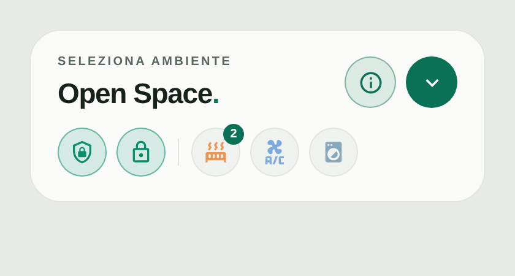
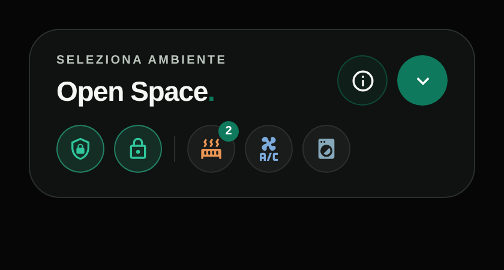
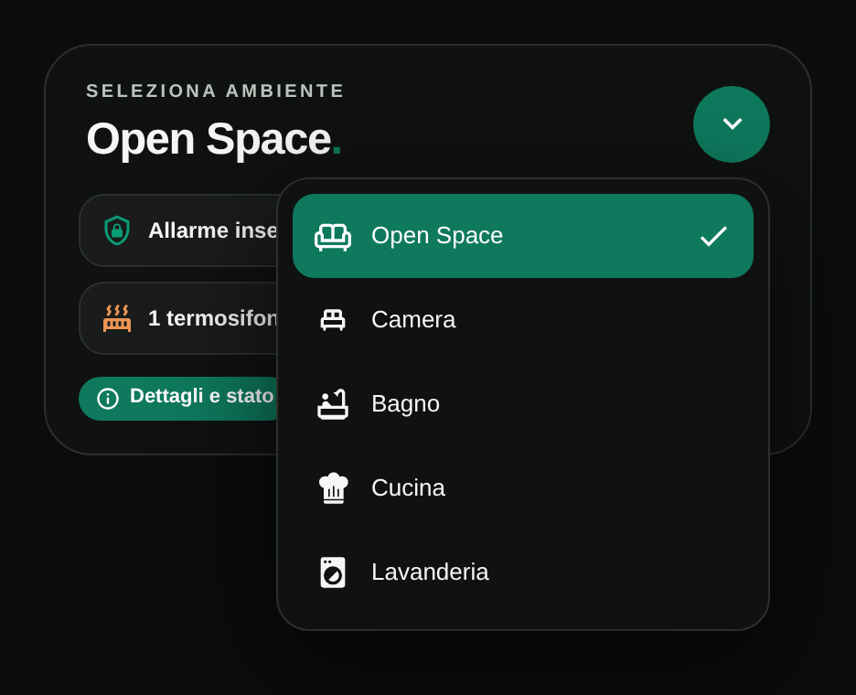
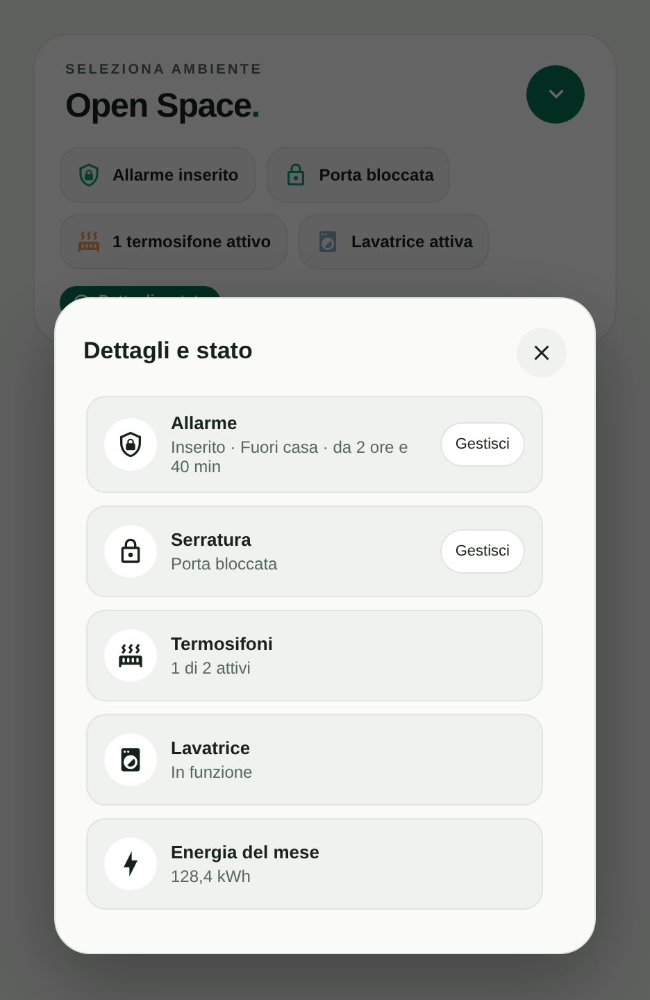

# Room Selector Card

[](https://my.home-assistant.io/redirect/hacs_repository/?owner=luigi-regolo&repository=room-selector-card&category=plugin)
[](https://github.com/luigi-regolo/room-selector-card/releases/latest)
[](LICENSE)
[](https://github.com/luigi-regolo/room-selector-card/stargazers)

## Overview

**Room Selector Card** is a custom dashboard card for Home Assistant that combines room selection with a compact overview of home-wide device states.

Its minimalist, responsive interface follows the Edera Light and Graphite Dark visual style, with rounded surfaces and native Home Assistant Material Design Icons.

The selected room can be used by existing Home Assistant automations and dashboard configurations, while the status indicators remain independent of room selection.

## Preview

| Light | Dark |
| --- | --- |
|  |  |

| Room menu, Dark mode | Details popup, Light mode |
| --- | --- |
|  |  |

*Previews use fictional demo data. The interface text is currently in Italian.*

## Features

- **Room selection:** Switch between options provided by an existing `input_select` or `select` entity.
- **Custom room icons:** Configure Material Design Icons for individual rooms.
- **Optional card name:** Show or hide the small label above the room name. The room name is always displayed.
- **Status icon bar:** Alarm and door-lock icons are always displayed, with colors for normal, warning, critical, and unavailable states.
- **Active devices:** Heating, cooling, washing machine, dryer, and custom indicators appear after a separator when active, with a counter when more than one device is active.
- **Details popup:** Open it from the optional information button or by tapping any status icon, which jumps directly to the matching item. It shows alarm, door-lock, heating, cooling, appliance, and monthly energy information.
- **Stable page:** Opening the popup does not move the dashboard behind it.
- **Duration sensors:** Optionally display available timing information for the away alarm, heating, cooling, washing machine, and dryer.
- **Security actions:** Optionally run a configured away-alarm script or lock a door through a compatible `lock.*` entity or dedicated script, with confirmation.
- **Native Home Assistant controls:** Open the entity interface for alarm and door-lock management.
- **Custom indicators:** Monitor additional configured Home Assistant entities.
- **Visual editor:** Configure rooms, indicators, appearance, and advanced settings without writing YAML.
- **Edera appearance:** Automatic, Light, and Dark modes.
- **Responsive layout:** Compact card and details popup designed for desktop, tablet, and smartphone dashboards.

Available features depend on the configured Home Assistant entities and integrations.

## Installation

### HACS (Recommended)

Install Room Selector Card directly from the default HACS catalog.

[](https://my.home-assistant.io/redirect/hacs_repository/?owner=luigi-regolo&repository=room-selector-card&category=plugin)

1. Open **HACS** in Home Assistant.
2. Search for **Room Selector Card**.
3. Select **Room Selector Card** from the results.
4. Click **Download** to install the card.
5. Reload your dashboard if necessary.
6. Add **Room Selector Card** to your dashboard and configure it using the visual editor.

To install a specific release, use **Download** or **Redownload** and select the desired version when available.

### Alternative: Custom repository

If you prefer to add the repository manually:

1. Open **HACS** and select **Custom repositories** from the menu.
2. Enter `https://github.com/luigi-regolo/room-selector-card`.
3. Select **Dashboard** as the repository type and add it.
4. Find **Room Selector Card** in HACS and download it.

### Manual installation

1. Download `dist/room-selector-card.js` from this repository.
2. Copy it into the `www` directory of your Home Assistant configuration.
3. Open **Settings → Dashboards → Resources** and add `/local/room-selector-card.js` as a **JavaScript module**.
4. Reload the dashboard and add Room Selector Card.

## Configuration and Usage

Open the Home Assistant dashboard editor, add Room Selector Card, and configure it using the native visual editor.

The editor provides four sections: **Ambienti** (Rooms), **Indicatori** (Indicators), **Aspetto** (Appearance), and **Avanzate** (Advanced).

An existing `input_select` or `select` entity is required to supply the available rooms. The card changes its selected option using Home Assistant services.

### Example YAML configuration

```yaml
type: custom:room-selector-card
selection_entity: input_select.example_rooms
theme_mode: auto
alarms:
  - alarm_control_panel.example_alarm
lock_entity: lock.example_front_door
```

Replace the example identifiers with entities from your own Home Assistant installation.

### Optional security actions

The visual editor supports:

- **Away alarm:** Select an existing `script.*` entity that activates your away-alarm procedure.
- **Lock door:** Select the monitored `lock.*` entity or a dedicated `script.*` entity that locks the door.

These actions must be explicitly configured and require confirmation. They are offered only when the corresponding monitored device state allows the action.

The card does not provide a direct door-unlock shortcut. Other indicators are informational.

Security commands are executed through Home Assistant services and depend on the permissions and behavior of the configured entities or scripts.

Unknown or unavailable states are never treated as confirmation that a device is secure. A submitted command does not independently prove that a physical device has completed the operation.

## Compatibility and Requirements

Room Selector Card requires:

- Home Assistant with support for custom JavaScript dashboard cards.
- An existing `input_select` or `select` entity containing the room options.
- Compatible Home Assistant entities for the optional indicators and actions.

A specific minimum Home Assistant version has not been independently verified.

The card does not require additional JavaScript libraries, subscriptions, or dedicated external cloud services.

## Releases

See [GitHub Releases](https://github.com/luigi-regolo/room-selector-card/releases) for published versions and release notes.

## Copyright & License

Copyright © 2026 luigi-regolo.

Original project created and maintained by **luigi-regolo**.

Licensed under the **GNU General Public License version 3 only (GPL-3.0-only)**.

See the [LICENSE](LICENSE) file for the complete license terms.

The software is provided without warranty to the extent permitted by applicable law.
