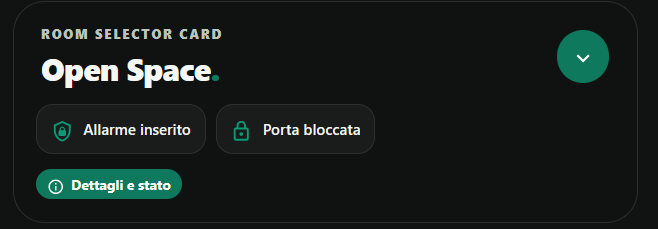

# Room Selector Card

[](https://www.tiktok.com/@luigi.regolo)
[](LICENSE)
[](https://my.home-assistant.io/redirect/hacs_repository/?owner=luigi-regolo&repository=room-selector-card&category=plugin)
[](https://github.com/luigi-regolo/room-selector-card/stargazers)

## Overview

**Room Selector Card** is a custom dashboard card for Home Assistant that combines room selection with a compact overview of home-wide device states.

Its minimalist, responsive interface follows the Edera Light and Graphite Dark visual style, with rounded surfaces and native Home Assistant Material Design Icons.

The selected room can be used by existing Home Assistant automations and dashboard configurations, while the status indicators remain independent of room selection.

## Preview



*Room Selector Card in Edera Graphite Dark mode, showing a configured room, alarm status, and door lock status.*

## Features

- **Room selection:** Switch between options provided by an existing `input_select` or `select` entity.
- **Custom room icons:** Configure Material Design Icons for individual rooms.
- **Security status:** Always display the configured alarm and door-lock states, including unavailable states.
- **Conditional indicators:** Show heating, cooling, washing machine, and dryer indicators when active.
- **Details popup:** View alarm, door-lock, heating, cooling, appliance, and monthly energy information.
- **Duration sensors:** Optionally display available timing information for the away alarm, heating, cooling, washing machine, and dryer.
- **Security actions:** Optionally run a configured away-alarm script or lock a door through a compatible `lock.*` entity or dedicated script, with confirmation.
- **Native Home Assistant controls:** Open the entity interface for alarm and door-lock management.
- **Custom indicators:** Monitor additional configured Home Assistant entities.
- **Visual editor:** Configure rooms, indicators, appearance, and advanced settings without writing YAML.
- **Edera appearance:** Automatic, Light, and Dark modes.
- **Responsive layout:** Compact card and details popup designed for desktop, tablet, and smartphone dashboards.

Available features depend on the configured Home Assistant entities and integrations.

## Installation

### HACS

Install Room Selector Card using a custom HACS repository.

1. Open **HACS** in Home Assistant.
2. Open the HACS menu and select **Custom repositories**.
3. Enter the repository URL:

   `https://github.com/luigi-regolo/room-selector-card`

4. Select **Dashboard** as the repository type and add it.
5. Find **Room Selector Card** in HACS and download it.
6. Reload the dashboard if necessary, then add the card using the visual editor.

### Manual installation

1. Download `dist/room-selector-card.js` from this repository.
2. Copy it into the `www` directory of your Home Assistant configuration.
3. Open **Settings → Dashboards → Resources** and add `/local/room-selector-card.js` as a **JavaScript module**.
4. Reload the dashboard and add Room Selector Card.

## Configuration and Usage

Open the Home Assistant dashboard editor, add Room Selector Card, and configure it using the native visual editor.

The editor provides four sections: **Ambienti** (Rooms), **Indicatori** (Indicators), **Aspetto** (Appearance), and **Avanzate** (Advanced).

An existing `input_select` or `select` entity is required to supply the available rooms. The card changes its selected option using Home Assistant services.

### Example YAML configuration

```yaml
type: custom:room-selector-card
selection_entity: input_select.example_rooms
theme_mode: auto
alarms:
  - alarm_control_panel.example_alarm
lock_entity: lock.example_front_door
```

Replace the example identifiers with entities from your own Home Assistant installation.

### Optional security actions

The visual editor supports:

- **Away alarm:** Select an existing `script.*` entity that activates your away-alarm procedure.
- **Lock door:** Select the monitored `lock.*` entity or a dedicated `script.*` entity that locks the door.

These actions must be explicitly configured and require confirmation. They are offered only when the corresponding monitored device state allows the action.

The card does not provide a direct door-unlock shortcut. Other indicators are informational.

Security commands are executed through Home Assistant services and depend on the permissions and behavior of the configured entities or scripts.

## Compatibility and Requirements

Room Selector Card requires:

- Home Assistant with support for custom JavaScript dashboard cards.
- An existing `input_select` or `select` entity containing the room options.
- Compatible Home Assistant entities for the optional indicators and actions.

A specific minimum Home Assistant version has not been independently verified.

The card does not require additional JavaScript libraries, subscriptions, or dedicated external cloud services.

## Privacy and Security

Room Selector Card uses the entities, services, and permissions already available in Home Assistant.

The card does not implement advertising, telemetry, analytics, or external tracking services.

Unknown or unavailable device states are not treated as confirmation that a device is secure.

Optional alarm and lock actions require confirmation before a service call is sent. A successfully submitted command does not independently prove that a physical device has completed the requested operation.

Scripts and device integrations may perform additional operations according to their own configurations. Review those operations before enabling security shortcuts.

## Copyright & License

Copyright © 2026 luigi-regolo.

Original project created and maintained by **luigi-regolo**.

Licensed under the **GNU General Public License version 3 only (GPL-3.0-only)**.

See the [LICENSE](LICENSE) file for the complete license terms.

The software is provided without warranty to the extent permitted by applicable law.
